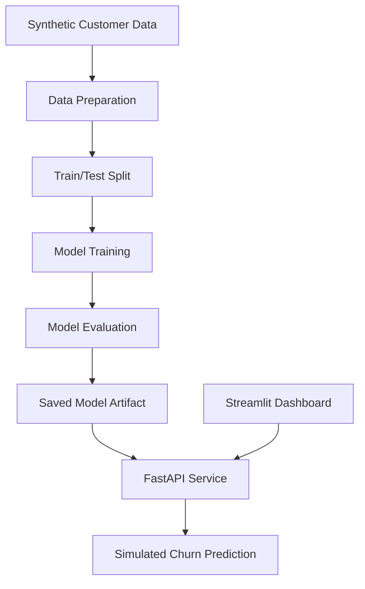

# 🚀 Production MLOps Platform

### Machine Learning Engineering | Synthetic Customer Churn Prediction


An end-to-end **machine learning engineering prototype** demonstrating reproducible model training, evaluation, API development, interactive predictions and software testing.

Built using Python, Scikit-learn, FastAPI, Streamlit and Docker to explore the foundations of MLOps and production-oriented machine learning systems.

> **Project Status:** Educational prototype under development. All customer data and churn labels are synthetic. The project is not a production-ready system.

---

## 📌 Project Overview

This project demonstrates how a machine learning model can be developed, evaluated and integrated with a prediction API and interactive web application.

It includes:

- Synthetic customer data generation
- Reproducible machine learning training
- Logistic regression classification
- Experimental random forest modelling
- Model evaluation and saved artifacts
- FastAPI prediction endpoints
- Interactive Streamlit dashboard
- Automated Python tests
- Docker containerisation

## 🏗️ System Architecture



## 🛠️ Technology Stack

| Technology | Purpose |
|---|---|
| Python | Application development |
| Pandas & NumPy | Data processing |
| Scikit-learn | Machine learning |
| FastAPI | REST prediction API |
| Pydantic | Input validation |
| Streamlit | Interactive user interface |
| Pytest | Automated testing |
| Docker | Containerisation |
| GitHub | Version control |

## ✨ Key Features

**Machine Learning**

- Deterministic synthetic dataset generation
- Stratified training and testing split
- Feature scaling and logistic regression
- Classification probability prediction
- Evaluation using accuracy, ROC-AUC and average precision

**Prediction API**

- `/predict` endpoint
- `/health` endpoint
- Input validation
- Automatic Swagger API documentation
- JSON prediction responses

**Interactive Dashboard**

- Customer tenure controls
- Monthly spending controls
- Support ticket inputs
- Simulated churn probability display
- Prediction classification

**Software Engineering**

- Modular Python files
- Automated unit and API tests
- Dockerfile for API execution
- Reproducible training configuration

## 📁 Project Structure

The intended project organisation is:

```text
production-mlops-platform/
│
├── src/
│   ├── __init__.py
│   ├── features.py
│   ├── train.py
│   ├── model.py
│   ├── api.py
│   └── dashboard.py
│
├── test_api.py
├── test_model.py
├── test_train.py
├── Dockerfile
├── requirements.txt
└── README.md
```

**Important:** The current GitHub repository has its Python files at the root. They must be moved into `src/` to match the existing imports and Dockerfile before the commands below can work correctly.

## 💻 Getting Started

### 1. Clone the repository

```bash
git clone https://github.com/tasnem-tech/production-mlops-platform.git
cd production-mlops-platform
```

### 2. Create a virtual environment

```bash
python3 -m venv .venv
source .venv/bin/activate
```

### 3. Install dependencies

```bash
python -m pip install -r requirements.txt
```

### 4. Train the model

After correcting the `src/` directory structure:

```bash
python -m src.train
```

### 5. Start the API

```bash
python -m uvicorn src.api:app --reload
```

API documentation:

http://localhost:8000/docs

### 6. Launch the dashboard

In another terminal:

```bash
source .venv/bin/activate
python -m streamlit run src/dashboard.py
```

Dashboard:

http://localhost:8501

Both FastAPI and Streamlit must be running for predictions to work.

## 🔌 API Example

```bash
curl -X POST http://localhost:8000/predict \
  -H "Content-Type: application/json" \
  -d '{
    "tenure_months": 12,
    "monthly_spend": 90,
    "support_tickets": 3
  }'
```

The API returns a simulated churn probability, classification and an educational-use warning.

## 🧪 Automated Testing

```bash
python -m pytest -q
```

The repository includes tests for model training, reproducibility, API responses and input validation.

## 🐳 Docker

After correcting the package structure:

```bash
docker build -t churn-api .
docker run --rm -p 8000:8000 churn-api
```

Docker runs the FastAPI service. Streamlit remains a separate application.

## 📊 Model Evaluation

| Metric | Purpose |
|---|---|
| Accuracy | Classification correctness |
| ROC-AUC | Class discrimination |
| Average Precision | Precision-recall performance |
| Positive Rate | Class distribution |

Evaluation results are generated from synthetic data and must not be interpreted as validated real-world performance.

## 🔐 Security and Limitations

- Uses synthetic data only.
- No real customer information is required.
- No authentication or rate limiting is currently implemented.
- The API should not be exposed directly to the public internet.
- Model artifacts must come from trusted sources.
- GitHub Actions CI and a verified public deployment have not yet been added.

## 🚀 Development Roadmap

- [ ] Correct Python source folder structure
- [ ] Verify the complete application locally
- [ ] Add GitHub Actions CI/CD testing
- [ ] Add dashboard screenshots
- [ ] Publish a secure live demonstration
- [ ] Integrate MLflow experiment tracking
- [ ] Add model registry and versioning
- [ ] Implement drift monitoring
- [ ] Introduce structured logging
- [ ] Add authentication and API security
- [ ] Document cloud deployment and rollback

## 💡 Skills Demonstrated

Python · Machine Learning · Data Processing · Model Evaluation · FastAPI · Streamlit · REST APIs · Pytest · Docker · GitHub

## 👩‍💻 Developer

**Tasnem Islam Prome**

BSc (Hons) Applied Computing  
University of Portsmouth

Interested in AI, Machine Learning Engineering, Data Analytics and Software Development.

**GitHub:** [tasnem-tech](https://github.com/tasnem-tech)

**Project:** [Production MLOps Platform](https://github.com/tasnem-tech/production-mlops-platform)

---

*An educational machine learning engineering portfolio project developed using synthetic data.*
